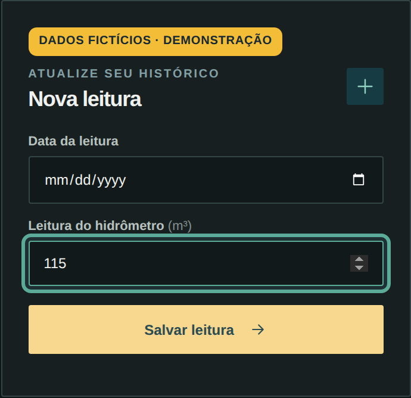
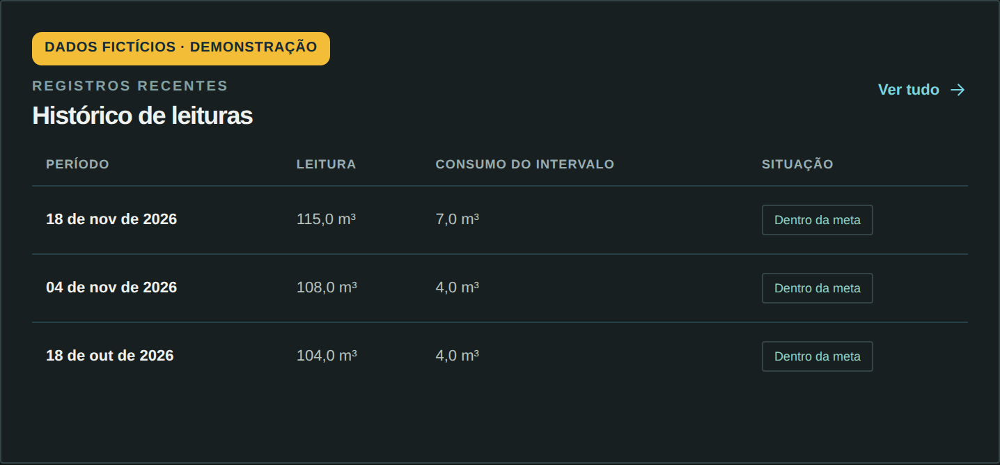
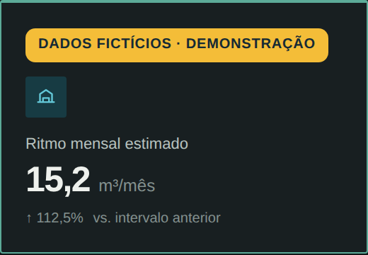
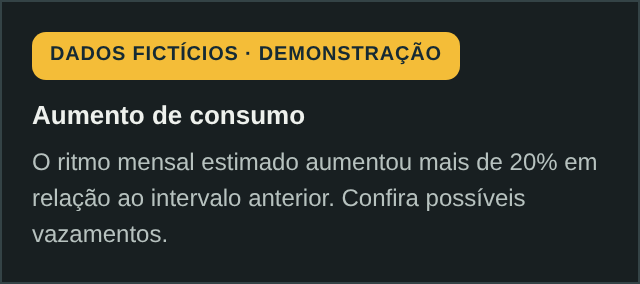

# GotaVértice — kit editorial orgânico de quatro semanas

**Versão:** 1.0 · 18 de novembro de 2026
**Status:** textos revisados para validação do responsável pelo produto; ainda não publicados.
**Cadência:** uma peça principal por semana, sem datas fixas.
**Público prioritário:** pessoas que acompanham as contas da própria residência e querem organizar leituras do hidrômetro.

O kit segue a pauta aprovada no plano de marketing: (1) localizar e registrar uma leitura, (2) entender por que uma leitura isolada não mostra evolução, (3) comparar períodos sem conclusões precipitadas e (4) explicar o que o alerta de variação mostra e o que não pode concluir. O posicionamento é clareza e acompanhamento — não economia garantida, monitoramento em tempo real ou diagnóstico de vazamento. [1]

## Orientação para uso das imagens

As quatro capturas anexas mostram a interface real do dashboard rodando em navegador, mas foram feitas no branch de desenvolvimento da PR de UI #78, com Firebase substituído por dados de demonstração. A faixa amarela “DADOS FICTÍCIOS · DEMONSTRAÇÃO” permanece visível. Leituras, residência e conta são sintéticas; não são dados de participantes nem retratos da produção. Use-as para selecionar telas e planejar as peças, não como imagens finais de publicação.

Antes de publicar, recapture a versão já integrada e implantada; remova ou corte os campos de demonstração que não forem necessários; mantenha os números claramente marcados como ilustrativos. Não use captura, fala ou depoimento de usuário sem autorização específica, revisão pela própria pessoa e remoção de dados identificáveis. Este kit não ativa pixels, cookies não essenciais ou analytics.

## Semana 1 — O que registrar no hidrômetro

**Formato sugerido:** carrossel de cinco telas, estático.
**Tela de capa:** “Vai registrar a leitura? Confira o mostrador primeiro.”

**Roteiro das telas:**

1. “Antes de anotar, confira a orientação da sua concessionária.”
2. “Na orientação publicada pela Sanepar, a leitura usa os números pretos; os números vermelhos não entram no registro.” [2]
3. “O consumo do intervalo é a leitura atual menos a leitura anterior.” [2]
4. “Os visores podem variar. Se tiver dúvida, consulte o guia da concessionária que atende seu endereço.”
5. “Depois, registre a data e a leitura. Salve este guia para a próxima vez.”

**Legenda sugerida:** “Uma leitura fica mais útil quando você registra também a data e consegue compará-la com a anterior. A Sanepar orienta anotar os números pretos do seu exemplo de hidrômetro e não os vermelhos; confirme sempre o padrão do equipamento e as instruções da concessionária da sua região. O GotaVértice permite inserir a leitura manualmente e organizar os registros ao longo do tempo.” [2]

**CTA:** “Salve para consultar na próxima leitura.”
**Tela selecionada:** [formulário real de nova leitura](assets/02-registro-de-leitura.png).
**Texto alternativo:** “Dashboard do GotaVértice em tema escuro, com o formulário de nova leitura mostrando campos de data e valor do hidrômetro. A imagem tem faixa ‘Dados fictícios · demonstração’; os valores não são de um participante.”

**Atenção à captura:** o Chromium automatizado usado no teste mostra o placeholder nativo da data como “mm/dd/yyyy”. Não publicar esse recorte; recapturar em um navegador pt-BR ou substituí-lo pelo recorte do histórico antes da publicação.

## Semana 2 — Uma leitura isolada não mostra evolução

**Formato sugerido:** carrossel de quatro telas, com a tela do histórico como demonstração.
**Tela de capa:** “Uma leitura é um ponto. O histórico aparece com o tempo.”

**Roteiro das telas:**

1. “Um único número registra um momento, mas não compara períodos.”
2. “Com duas leituras datadas, o GotaVértice calcula a diferença entre elas.” [3]
3. “O intervalo entre as datas importa para interpretar o ritmo estimado.” [3]
4. “Continue registrando suas próprias leituras para construir um histórico da residência.”

**Legenda sugerida:** “O primeiro registro organiza o ponto de partida. Uma leitura posterior permite comparar um intervalo; novas leituras ajudam a acompanhar como esse ritmo muda. O app depende dos valores que você registra manualmente e não substitui a leitura oficial da concessionária.” [1] [3]

**CTA:** “Veja como registrar leituras.”
**Tela selecionada:** [histórico e formulário no dashboard](assets/03-historico.png).
**Texto alternativo:** “Captura do dashboard com a tabela de leituras recentes e o formulário de registro ao lado. O ambiente e os valores são uma demonstração sintética identificada como fictícia.”

## Semana 3 — Compare períodos sem pular para uma conclusão

**Formato sugerido:** carrossel educativo de cinco telas; o exemplo deve permanecer identificado como hipotético em todas as peças derivadas.
**Tela de capa:** “Uma variação merece contexto.”

**Roteiro das telas:**

1. “Exemplo hipotético: 100 para 104 m³ em 17 dias; depois, 104 para 108 m³ em 17 dias.”
2. “No intervalo seguinte: 108 para 115 m³ em 14 dias.”
3. “Como os intervalos têm durações diferentes, o app estima um ritmo mensal proporcional aos dias.” [3]
4. “Neste exemplo sintético, o último ritmo estimado sobe de cerca de 7,2 para 15,2 m³/mês. A variação não explica a causa.” [3]
5. “Confira datas e registros; considere o contexto de uso antes de tirar conclusões.”

**Legenda sugerida:** “Os números desta demonstração são inventados. O GotaVértice normaliza o consumo pelo número de dias entre as leituras e compara o ritmo mensal estimado; o cálculo pressupõe consumo uniforme e fica mais informativo com registros adequados. Uma mudança pode merecer conferência, mas não prova economia, desperdício ou vazamento.” [3]

**CTA:** “Teste o acompanhamento com suas próprias leituras.”
**Tela selecionada:** [cartão de comparação do ritmo mensal estimado](assets/01-comparacao-de-ritmo.png).
**Texto alternativo:** “Cartão do GotaVértice mostrando um ritmo mensal estimado de 15,2 m³ e aumento de 112,5% em relação ao intervalo anterior. A faixa amarela identifica valores sintéticos; o exemplo não é uma previsão de conta nem um diagnóstico.”

## Semana 4 — O que o alerta mostra e o que não mostra

**Formato sugerido:** FAQ visual de quatro telas, usando a captura da notificação.
**Tela de capa:** “Um alerta ajuda a perguntar. Não dá um diagnóstico.”

**Roteiro das telas:**

1. “O aviso de variação compara o ritmo mensal estimado do intervalo atual com o anterior.” [3]
2. “Esse aviso específico aparece quando a estimativa aumenta mais de 20% em relação ao intervalo anterior.” [3] [4]
3. “Ele não identifica a causa e não confirma vazamento. Confira primeiro datas e leituras; depois, investigue os hábitos e os pontos hidráulicos.”
4. “O GotaVértice organiza registros. A avaliação da instalação exige verificação apropriada.”

**Legenda sugerida:** “O alerta é um sinal para conferir, não uma conclusão. Uma variação pode ter diferentes explicações, inclusive mudanças de uso ou um registro que merece revisão. O app não localiza vazamentos nem determina a causa. Se a dúvida persistir, procure a concessionária ou um profissional qualificado.”

**CTA:** “Conheça os limites do alerta.”
**Tela selecionada:** [notificação de aumento de consumo](assets/04-notificacao.png).
**Texto alternativo:** “Captura do dashboard com o painel ‘Aumento de consumo’ aberto. A mensagem compara o ritmo mensal estimado ao intervalo anterior e está identificada como demonstração com dados fictícios.”

**Nota interna para revisão antes de publicar:** além do alerta relativo acima de 20%, o código atual tem uma regra distinta para ritmo mensal estimado acima de 18 m³/mês. Esse limite é um parâmetro do produto, não um padrão de concessionária nem uma referência universal para residências. Não resumir todos os estados do alerta como se houvesse um único gatilho; alinhar a explicação pública ao comportamento da versão implantada. [3] [4]

## Checklist de publicação

- Confirmar que a versão e as telas ainda correspondem ao produto implantado; as capturas atuais são do branch de desenvolvimento associado à PR #78.
- Manter “exemplo hipotético” ou “dados fictícios” visível sempre que forem usados números de demonstração.
- Recortar a interface para destacar a função demonstrada e remover dados que não sejam necessários.
- Incluir texto alternativo, legendas e contraste suficiente; não usar apenas cor para explicar um estado.
- Conferir a orientação factual da concessionária pertinente antes de republicar dicas de leitura do hidrômetro.
- Não prometer economia ou redução de conta, nem dizer que o app detecta ou diagnostica vazamentos.
- Não publicar dados, capturas ou depoimentos de usuários sem autorização específica e revisão da pessoa.
- Não enviar leituras, consumo, endereço, nome, e-mail ou identificadores de conta para ferramentas de marketing. Nenhum analytics foi ativado por este kit.

## Referências

[1]: https://docs.google.com/document/d/1IbqKe2EncqLAF1WdQmbskCA4nq3LZcg7qs9oN_Xve9w/edit "Plano de marketing do GotaVértice"
[2]: https://www.sanepar.com.br/meu-consumo "Meu Consumo — Sanepar"
[3]: https://github.com/gabrielaraujo-eng/GotaVertice/blob/main/public/consumption.js "Cálculos de consumo do GotaVértice"
[4]: https://github.com/gabrielaraujo-eng/GotaVertice/blob/main/public/app.js "Mensagens e notificações do dashboard GotaVértice"
